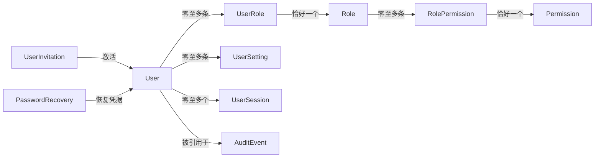

# IAM 领域设计

- **状态：** Draft proposal（对应 PRD 1.1 Draft；设计关卡 Exploratory）
- **版本：** 0.5
- **日期：** 2026-10-20
- **适用范围：** PRD 1.1 Draft B1：员工身份、登录恢复、RBAC、个人资料与用户设置、平台设置、审计；产品范围待重新审批。
- **来源：** [IAM 管理平台 PRD](../prd/iam-management-platform.md) 与 `spring-boot-developer` 技能工作流。

本文定义产品领域概念和规则，不定义数据库表结构或 Java 实体。当前规则是设计提案；只有在产品/契约负责人确认后才成为接受的领域契约。

## 核心模型

| 模型 | 职责 | 关键属性 | 身份与生命周期 |
| --- | --- | --- | --- |
| User（用户） | 表示可认证并被授权的员工 | 稳定用户 ID、规范化唯一邮箱、邮箱验证状态、密码摘要、必填 `name`、状态 | ID 不随邮箱变化；`Invited → Active → Disabled`。首版只停用账号，不提供硬删除。 |
| UserInvitation（用户邀请） | 邀请已有 `Invited` 状态的 User 完成邮箱验证和激活 | ID、User ID、令牌摘要、到期时间、使用/撤销状态 | 一次性；默认 72 小时有效；重发时撤销旧邀请。目标邮箱取自关联 User。 |
| PasswordRecovery（密码重置） | 限时证明用户账号重置密码请求 | 用户 ID、令牌摘要、到期时间、使用状态 | 一次性；默认 30 分钟有效；成功后撤销该用户所有活动会话。 |
| Role（角色） | 命名的一组权限 | ID、名称、描述、是否内置 | 可分配给多个 User；管理员可维护自定义角色和权限关联，内置角色不可删除。 |
| Permission（权限） | 对受保护资源执行操作的授权原子 | 稳定权限标识、资源、操作 | 可授予多个 Role；首版权限目录由产品定义。 |
| UserRole（用户角色关联） | 表达 User 与 Role 的多对多关系并记录授予信息 | 用户 ID、角色 ID、授予者、授予时间 | 每条关联恰好引用一个 User 和一个 Role；同一对至多一条有效关联。 |
| RolePermission（角色权限关联） | 表达 Role 与 Permission 的多对多关系 | 角色 ID、权限 ID | 每条关联恰好引用一个 Role 和一个 Permission；同一对至多一条关联。 |
| UserSession（用户会话） | 表示已认证用户的一次 API 访问上下文 | 会话 ID、用户 ID、令牌摘要、创建时间、最近活动时间、空闲期限、绝对期限、撤销时间 | 使用 256-bit 随机不透明 Bearer token；空闲 15 分钟、绝对 8 小时；登出、超时、密码重置或用户停用时失效。 |
| AuditEvent（审计事件） | 记录可归因的身份与管理事实 | 事件 ID、发生时间、操作者、动作、目标、结果、关联 ID | 只追加；业务 API 不提供修改或删除。 |
| PlatformSetting（平台设置） | 按类型保存平台展示、邮件发送和邮件链接配置 | `type`、JSON `value`、变更者、变更时间 | 每种配置类型一条记录；只接受定义过的类型和对应 JSON 字段；SMTP 密码加密保存且不可读回。 |
| UserSetting（用户设置） | 按类型保存与单个 User 关联的个人偏好 | 用户 ID、`type`、JSON `value`、更新时间 | 每个用户每种类型一条记录；用户只能读写自己的设置；首批类型 `preferences`，包含语言、时区、主题。 |

## 关系



因此 `User` 与 `Role` 是多对多，`Role` 与 `Permission` 也是多对多；`UserRole` 和 `RolePermission` 分别承载两组关联及其约束。

## 字段清单（建议基线）

以下字段是首版领域/API 设计建议，不等同于最终 SQL schema。ID 默认使用 `Long`（如某项需求需要不透明外部标识，可另行选 `String`），不使用 UUID；关系由 ID 字段表达，建表语句不添加外键约束，并由应用层校验引用存在性和生命周期规则。时间使用 UTC `Instant`；邮箱按去除首尾空白并转为小写的规范化值保持唯一。所有密码、邮件令牌和会话令牌仅保存安全摘要，不保存明文。

| 模型 | 字段 | 类型 / 约束 | 说明 |
| --- | --- | --- | --- |
| `User` | `id` | Long，主键 | 稳定身份标识 |
|  | `email` | 字符串，非空、最大 254 字符、唯一、规范化 | 登录邮箱；首版不可变 |
|  | `emailVerifiedAt` | Instant，可空 | 邮箱验证时间；未验证为 null |
|  | `passwordHash` | 字符串，可空 | 激活时建立；使用 Spring Security 密码编码器 |
|  | `name` | 字符串，非空、最大 100 字符 | 用户显示名称；邀请接受时必填，用户或授权管理员可修改 |
|  | `status` | `Invited` / `Active` / `Disabled` | 账号生命周期状态 |
|  | `createdAt`, `updatedAt` | Instant，非空 | 创建与最近更新时间 |
| `UserInvitation` | `id`, `userId` | Long；`userId` 关联 User | 邀请创建时同步创建 `Invited` 状态的 User；目标邮箱使用 User.email，不重复存储 |
|  | `tokenHash` | 字符串，非空、唯一 | 邮件一次性令牌的安全摘要 |
|  | `expiresAt`, `usedAt`, `revokedAt` | Instant；后两者可空 | 72 小时有效；使用或撤销后失效 |
|  | `createdBy`, `createdAt` | Long，可空；Instant | 邀请发起者；初始管理员邀请没有操作者 |
| `PasswordRecovery` | `id`, `userId` | Long；`userId` 关联 User | 重置请求和所属用户；由应用验证关联有效 |
|  | `tokenHash` | 字符串，非空、唯一 | 不保存邮件中的明文令牌 |
|  | `expiresAt`, `usedAt`, `createdAt` | Instant；`usedAt` 可空 | 30 分钟有效且只能使用一次 |
| `Role` | `id` | Long，主键 | 角色标识 |
|  | `code` | 字符串，非空、唯一 | 稳定标识；内置角色 code 固定 |
|  | `name` | 字符串，非空、最大 100 字符 | 显示名称；规范化后唯一 |
|  | `description` | 字符串、最大 500 字符，可空 | 角色用途说明 |
|  | `builtIn` | 布尔，非空 | 内置角色不可删除 |
|  | `createdAt`, `updatedAt` | Instant，非空 | 创建与最近更新时间 |
| `Permission` | `id` | Long，主键 | 权限记录标识 |
|  | `code` | 字符串，非空、最大 100 字符、唯一 | 稳定权限码，如 `users:read` |
|  | `description` | 字符串，非空 | 权限用途说明；权限目录由平台提供 |
| `UserRole` | `userId`, `roleId` | Long 复合主键及关联 ID | 唯一用户角色关联；由应用验证两端记录存在 |
|  | `assignedBy`, `assignedAt` | Long，可空；Instant | 授予者和授予时间；初始化分配可无操作者 |
| `RolePermission` | `roleId`, `permissionId` | Long 复合主键及关联 ID | 唯一角色权限关联；由应用验证两端记录存在 |
| `UserSession` | `id`, `userId` | Long；`userId` 关联 User | 会话及所属用户；由应用验证关联有效 |
|  | `tokenHash` | 字符串，非空、唯一 | 256-bit 随机 bearer token 的摘要 |
|  | `createdAt`, `lastActivityAt` | Instant，非空 | 创建和最近活动时间 |
|  | `idleExpiresAt`, `absoluteExpiresAt` | Instant，非空 | 当前空闲期限和固定绝对期限 |
|  | `revokedAt`, `revokeReason` | Instant、字符串，可空 | 撤销时间与原因 |
| `AuditEvent` | `id`, `occurredAt` | Long；Instant，非空 | 事件标识和发生时间 |
|  | `actorUserId` | Long，可空 | 操作者；匿名认证失败时为空 |
|  | `action`, `targetType`, `targetId` | 字符串；`targetId` 可空 | 发生的操作及目标 |
|  | `outcome` | `Success` / `Failure` | 操作结果 |
|  | `requestId` | 字符串，非空 | 关联同一请求的日志与审计事件 |
|  | `safeMetadata` | JSON，可空 | 仅白名单非秘密信息；禁止密码、令牌、SMTP 凭据 |
| `PlatformSetting` | `id` | Long，主键 | 单条配置记录标识 |
|  | `type` | 字符串，非空、唯一；首批 `general`、`mail` | 指定 `value` JSON 的结构和字段白名单 |
|  | `value` | JSON 对象，非空 | `general` 含 `platformName`、`defaultLocale`、`frontendBaseUrl`；`mail` 含 `smtpHost`、`smtpPort`、`smtpUsername`、`smtpFromAddress`、`smtpAuthEnabled`、`smtpStartTlsEnabled`、`smtpPasswordEncrypted` |
|  | `updatedBy`, `updatedAt` | Long；Instant | 最后修改者和时间 |
| `UserSetting` | `id` | Long，主键 | 设置记录标识 |
|  | `userId` | Long，关联 ID | 设置所属 User；由应用验证 User 存在和当前操作者所有权 |
|  | `type` | 字符串，非空；首批仅 `preferences` | 与 `userId` 组成唯一键，避免同一用户重复拥有同类设置 |
|  | `value` | JSON 对象，非空 | `preferences` 含 `locale`（默认 `zh-CN`）、`timeZone`（默认 `Asia/Shanghai`）、`theme`（默认 `system`；`system`/`light`/`dark`） |
|  | `updatedAt` | Instant，非空 | 最近更新时间 |

SMTP 配置由平台管理员通过平台设置接口维护。密码在 TLS 请求中提交后由服务端使用仅部署环境持有的加密密钥加密；读取响应只提供 `smtpPasswordConfigured` 布尔值。密码字段不得进入审计载荷、日志、错误响应或普通数据库备份的可读内容。建议设置变更事件只记录哪些字段发生变化，不记录其值。

15 分钟空闲超时和 8 小时绝对期限是本项目对管理平台安全与工作时长的折中默认值，不是法规合规声明。OWASP 建议服务端强制空闲与绝对超时，并列出低风险应用常见 15–30 分钟空闲范围及办公日应用 4–8 小时绝对期限。[OWASP Session Management Cheat Sheet](https://cheatsheetseries.owasp.org/cheatsheets/Session_Management_Cheat_Sheet.html)

首版限定为单个企业组织，所有模型属于该组织边界。PRD 1.1 将此作为已确认产品输入。

## 领域规则

### 账号和凭据

- 邮箱是首版登录标识，用户注册/激活必须验证邮箱；企业邀请发送到目标邮箱，密码重置通过邮件发送一次性链接。
- 稳定用户 ID 与邮箱分离；邮箱在单个企业内规范化且唯一。首版不提供邮箱变更流程。
- 用户邀请有效 72 小时，密码重置链接有效 30 分钟；二者一次性使用。重发邀请/重置时使旧凭据失效。外部响应不得泄露邮箱是否存在。
- 首版不实现登录限流、失败次数锁定或密码复杂度/轮换策略；密码不得为空，存储时使用 Spring Security 提供的安全密码编码器。
- 停用账号不能登录；停用后的每个受保护请求都必须被拒绝，现有会话立即失效。
- 管理员可以重新启用已停用用户；原会话不会恢复，用户需重新登录。
- 首版不提供自助邮箱变更；个人资料首批仅含必填 `name`，由用户在邀请激活时设置，之后本人或有权限的管理员可修改。

### RBAC

- 用户与角色多对多，角色与权限多对多，分别由 `UserRole` 和 `RolePermission` 表达。用户可被分配多个角色。
- 用户的有效权限为所有有效角色权限的并集；默认拒绝；首版不支持显式拒绝。
- 角色授予、撤销、角色权限变更应在后续请求中生效；不得仅依赖登录时缓存的权限快照。
- 授权必须基于服务端可信的员工身份和当前角色/权限状态；界面隐藏不能替代服务端授权。
- 内置角色为 `PlatformAdmin`、`UserAdmin`、`Auditor`、`Employee`。只有 `PlatformAdmin` 可创建自定义角色、配置角色权限及管理平台设置；内置角色不可删除。`UserAdmin` 可为用户分配已存在的非 `PlatformAdmin` 角色。
- 系统必须始终保留至少一名活动的 `PlatformAdmin`；不得移除或停用最后一名活动平台管理员。
- `UserAdmin` 不能授予、撤销或修改 `PlatformAdmin`；只有 `PlatformAdmin` 可执行此类操作。

### 审计与平台设置

- 首批记录登录成功/失败、邀请/激活、重置请求/完成、用户资料与状态、角色/权限变更、平台设置变更和审计查询；不记录秘密、密码、完整邮箱验证/重置令牌。UserSetting 偏好变更不纳入首批审计。
- 审计记录不包含密码、会话 Cookie、令牌、完整秘密或可重放认证材料。
- 审计记录只追加，保留 365 天，到期后自动清理；不提供手工修改或删除 API。
- 成功登录创建 `UserSession`、关键业务状态变更及对应 `AuditEvent` 必须在同一数据库事务中提交；审计写入失败时该事务回滚，不留下会话或业务变更。范围包括邀请/激活、密码重置完成、用户资料/状态、角色/权限和平台设置变更。失败登录仍须记录审计事件；审计写入失败不改变认证拒绝结果，并产生运维错误。
- 平台设置使用 `type` + JSON `value` 存储；首批类型为 `general`（平台名称、默认语言、前端基础 URL）和 `mail`（SMTP 配置）。类型与 JSON 字段均采用白名单校验。SMTP 密码是唯一可写入的秘密；仅平台管理员可更新，密码加密保存且不返回，不记录至日志或审计载荷。
- 用户设置使用 `type` + JSON `value` 存储；首批仅允许 `preferences` 类型（语言、时区、主题）。用户只能读写自己的设置，不允许通过该能力修改身份、安全或授权数据。

## 状态转换

| 当前状态 | 命令 | 后续状态 | 结果 |
| --- | --- | --- | --- |
| 无 User | 管理员邀请 | `Invited` | 创建 User 与 UserInvitation 并发送限时邀请；User 不可登录 |
| `Invited` | 使用有效用户邀请完成激活 | `Active` | 凭据建立、邮箱验证完成、邀请失效 |
| `Invited` | 撤销或超过 72 小时有效期 | `Invited`（邀请无效） | 激活被拒绝；可由管理员重新邀请 |
| `Active` | 管理员停用 | `Disabled` | 立即拒绝访问并撤销全部会话 |
| `Disabled` | 管理员重新启用 | `Active` | 恢复访问；旧会话不恢复，用户需重新登录 |

密码恢复是凭据转换，不改变账号状态；账号停用期间恢复操作不得重新激活账号。

## 权限边界

首版权限目录固定为：`users:read`、`users:invite`、`users:write`、`users:disable`、`users:enable`、`roles:read`、`roles:write`、`user-roles:write`、`platform-settings:read`、`platform-settings:write`、`audit-events:read`。用户自己的资料和 UserSetting 由认证身份限定为本人，不通过可分配角色权限绕开所有权检查。只有 `PlatformAdmin` 可授予或撤销 `PlatformAdmin` 角色；不能停用最后一名活动平台管理员，也不能撤销其 `PlatformAdmin` 角色。

| 内置角色 | 权限 |
| --- | --- |
| `PlatformAdmin` | 全部内置权限；可管理平台设置和所有角色分配 |
| `UserAdmin` | `users:read`、`users:invite`、`users:write`、`users:disable`、`users:enable`、`roles:read`、`user-roles:write`；只能分配已存在的非 `PlatformAdmin` 角色 |
| `Auditor` | `audit-events:read` |
| `Employee` | 无管理权限；只能访问自身资料和 UserSetting |

## 部署配置项

| 配置 | 默认值 / 来源 | 用途 |
| --- | --- | --- |
| 邮件平台设置 | 管理员在平台设置 API 配置 SMTP 主机、端口、用户名、密码、发件人、认证和 STARTTLS | 发送邀请和密码重置邮件 |
| 本地邮件服务 | Docker Compose 启动 Mailpit；本地默认 `mailpit:1025`、无认证、无 TLS；Web UI 使用 `localhost:8025` | 接收开发邮件并查看；不可直接用于生产 |
| 前端基础 URL | 管理员在平台设置中配置，例如 `http://localhost:3000` | 生成邀请/重置链接；本项目不托管前端 |
| SMTP 加密密钥 | 通过部署 Secret 注入，不存入 PlatformSetting | 加密存储 SMTP 密码；生产环境必须配置 |
| CORS origin | 部署提供的精确白名单，默认拒绝 | 允许独立前端调用 API；不从可编辑平台设置动态扩展 |
| 初始平台管理员 | 一次性初始化流程指定邮箱并验证；无共享默认密码 | 初次启动并安全建立管理访问 |
| 审计查询 | 查询动作记录操作者、时间和结果；不保存敏感搜索值 | 审计访问本身可追踪，不对该追踪事件重复审计 |

首位 `PlatformAdmin` 由一次性初始化命令创建为待验证邀请，向指定邮箱发送验证链接，用户验证邮箱并设置密码后激活。正常运行期间不得通过公开注册创建账户；初始化命令只能在系统尚无平台管理员时运行，重复执行不得覆盖已有用户或凭据。首次启动时以部署初始化配置种入 SMTP 和前端基础 URL：本地使用 `http://localhost:3000`、Mailpit `mailpit:1025`、`no-reply@roseiam.local`、无认证/无 TLS；其他环境由运维通过 Secret/环境变量提供初始 SMTP 连接参数。首次管理员激活后，平台设置成为邮件配置的管理入口和运行时数据源，管理员可在其中修改设置。启用 SMTP 密码认证时必须配置邮件密码加密密钥。

## 修订历史

| 版本 | 日期 | 变更 | 状态 |
| --- | --- | --- | --- |
| 0.1 | 2026-10-20 | 初始领域模型与规则提案 | 待确认 |
| 0.3 | 2026-10-20 | 明确全部领域字段，邮件与前端链接改由平台设置管理 | PRD 1.1 待审批 |
| 0.4 | 2026-10-20 | PlatformSetting 和 UserSetting 改为 type + JSON value 字段模型 | PRD 1.1 待审批 |
| 0.5 | 2026-10-20 | 移除支持联系邮箱；明确邀请时创建 Invited User，并补齐审计范围与失败行为 | PRD 1.1 待审批 |

## Spring Boot 技术方案

本仓库目前没有构建配置或应用代码。以下技术栈和结构是新项目建议，不代表已经采用。`spring-boot-developer` 技能的版本清单于 2026-10-13 校准；Spring 官方文档当前列出 Spring Boot 4.1.1，并要求 Java 17+、兼容至 Java 26。初始化项目时应再次核对版本。[Spring Boot 系统要求](https://docs.spring.io/spring-boot/system-requirements.html) PostgreSQL 官方版本策略显示 18 为当前受支持主版本之一，建议部署时使用该主版本的最新小版本。[PostgreSQL 版本策略](https://www.postgresql.org/support/versioning/)

| 项目 | 建议 | 状态 / 原因 |
| --- | --- | --- |
| 应用框架 | Spring Boot 4.1.1、Spring Framework 7 | 新项目候选基线，待确认 |
| 语言 | Java 25 | 技能默认工具链，待确认本机/CI 支持 |
| 构建 | Maven Wrapper | 技能默认工作流，固定构建工具版本 |
| Web | Spring MVC | 适用于请求/响应型管理 API；无当前需求要求 WebFlux |
| 持久化 | PostgreSQL 18 | 候选关系数据库；生产托管方式由部署环境确定 |
| 架构形态 | 按业务能力组织的模块化单体 | 首批规模不需要微服务拆分 |
| API | JSON REST，基路径 `/api` | 与 [API 契约](../api.md) 对齐 |
| 认证 | 前后端分离 API 使用不透明 Bearer token，并在服务端维护 `UserSession` | 与即时撤销一致；不采用自包含 JWT |
| Schema 迁移 | 使用显式迁移工具 | 工具待选；生产运行不依赖自动改表 |

### 模块边界

建议根包放置启动类，按业务能力组织模块，避免全局按技术层拆包：

```text
<root-package>/
  Application.java
  config/              # Spring Security、全局 Web 与错误处理
  identity/            # 登录、恢复、邀请、用户生命周期、个人资料
  userrole/            # UserRole 关联
  rolepermission/      # RolePermission 关联
  role/                # 角色与权限目录
  platformsetting/     # 白名单平台设置
  usersetting/         # 语言、时区、主题等用户偏好
  audit/               # 只追加审计写入与查询
```

HTTP 控制器只负责请求绑定和响应映射；业务规则放在用例边界；使用专用 Request/Response DTO，不暴露持久化实体。跨模块通过明确接口交互，不直接访问彼此的实体或 Repository。

### 安全与事务建议

- 使用 Spring Security 显式定义公开和受保护路由；使用其密码编码器，不自行实现密码散列。
- 不透明 Bearer token 通过 `Authorization` 请求头传递；服务端只存储令牌摘要。该认证不使用 Cookie，不以浏览器自动发送凭据，因此不依赖 CSRF token。
- 前后端分离 API 仅允许部署配置中的精确 CORS origin；不允许通配 origin，也不启用跨域 Cookie 凭据。
- 账号停用和角色变更必须在后续请求生效。建议每个受保护请求检查账号有效性；授权缓存必须能及时失效。具体方式由实现阶段的性能验证决定。
- 认证由全局安全配置负责；具体业务操作的 RBAC 判定放在对应模块的用例边界。
- 邀请/验证/重置凭据只存储安全表示，不写入日志、审计事件或错误响应。SMTP 密码加密保存且不可读回；加密密钥从部署 Secret 注入。
- 成功登录创建会话、关键管理状态变更及对应审计记录必须在同一数据库事务中提交；审计写入失败时回滚会话或业务状态变更。SMTP 发送是外部副作用，不纳入数据库事务；通知失败不得造成已提交状态与审计记录不一致，邮件重试策略在实现规格中定义。
- 生产 schema 使用版本化迁移；应用只依赖 SMTP 协议，不绑定邮件供应商；本地使用 Mailpit。

## 设计就绪评估

**PRD 状态：** Draft 1.1。**评估范围：** 拟修订 B1，FR-1–FR-8、NFR-1–NFR-5。当前没有既有领域/API 契约；以下覆盖均为提案，不满足设计就绪门槛。

| PRD 需求 | 领域契约 | API 契约 | 缺口 / 决策 |
| --- | --- | --- | --- |
| FR-1 登录与密码恢复 | Exploratory | Exploratory | 邮箱/密码、邮箱验证、邮件恢复及不透明 UserSession 已提案。 |
| FR-2 员工账号生命周期 | Exploratory | Exploratory | 邮件邀请、激活、停用和重新启用已提案。 |
| FR-3 角色与权限配置 | Exploratory | Exploratory | UserRole、RolePermission 多对多和内置角色已提案。 |
| FR-4 按 RBAC 授权 | Exploratory | Exploratory | 权限并集、默认拒绝、无显式拒绝已提案。 |
| FR-5 个人资料和用户设置 | Exploratory | Exploratory | 个人资料与语言/时区/主题设置已提案；邮箱不在首版自助变更。 |
| FR-6 基础系统设置 | Exploratory | Exploratory | 展示设置、前端基础 URL、SMTP 字段及 SMTP 密码只写/加密存储已提案。 |
| FR-7 审计记录与查询 | Exploratory | Exploratory | 事件集、365 天保留及关键事务行为已提案。 |
| FR-8 停用后撤销访问 | Exploratory | Exploratory | 后续请求即时生效，所有 UserSession 撤销已提案。 |
| NFR-1 服务端认证与授权 | Exploratory | Exploratory | Spring Security + 不透明 Bearer UserSession 已提案。 |
| NFR-2 停用后会话终止 | Exploratory | Exploratory | 每个受保护请求检查 UserSession、User 状态与当前权限已提案。 |
| NFR-3 审计隐私 | Exploratory | Exploratory | 不记录秘密；自动保留和清理已提案。 |
| NFR-4 可部署和初始化 | Exploratory | No API impact | Docker 化后端与 Docker Compose 本地依赖候选方案；生产部署目标待定。 |
| NFR-5 独立后端 API 与 CORS | Exploratory | Exploratory | JSON REST API、精确来源白名单已提案；具体 origin 由部署提供。 |

**评估结论：Exploratory。** PRD 1.1 尚待审批，因此所有领域/API 结论仍是提案，不能作为 `sdd-spec` 的 Ready 证据。PRD 1.1 获批后，应复核每项覆盖并转为 Ready 或列出具体阻塞。

### 已采用的建议默认值（PRD 1.1 待审批）

1. 单个企业组织；邮箱+密码，激活前验证邮箱；SMTP 参数与前端基础 URL 通过平台设置管理，本地开发使用 Mailpit。
2. 前后端分离，仅实现后端；使用不透明 Bearer token + 服务端 UserSession，不使用 JWT；15 分钟空闲超时、8 小时绝对期限。
3. 用户与角色、角色与权限均为多对多；多角色权限并集、默认拒绝、不支持显式拒绝；内置角色为 `PlatformAdmin`、`UserAdmin`、`Auditor`、`Employee`，最后一名活动平台管理员受保护。
4. 禁止登录限流和密码复杂度/轮换规则；邀请 72 小时、密码重置 30 分钟有效；无自助邮箱变更。
5. UserSetting 使用 `type + JSON value` 存储，首批类型为 `preferences`（语言、时区、主题）；PlatformSetting 使用 `type + JSON value` 存储，首批类型为 `general`（平台名称、默认语言、前端基础 URL）和 `mail`（SMTP 配置）；SMTP 密码加密保存且不可读回。
6. 审计首批覆盖认证、邀请/激活/重置、账号状态、RBAC 和平台设置变更；保留 365 天。关键变更和审计失败时一并失败。
7. Spring Boot 4.1.1、Java 25、Maven、Spring MVC、PostgreSQL 18、模块化单体为技术建议；用 Docker Compose 支持本地可重复运行，生产部署目标、SMTP 密码加密密钥和 CORS origin 由部署环境提供。

产品范围与默认值进入 PRD 1.1 Draft；经用户批准后，将本文和 [API 契约](../api.md) 转为接受契约并更新覆盖状态，再进入 `sdd-spec`。
